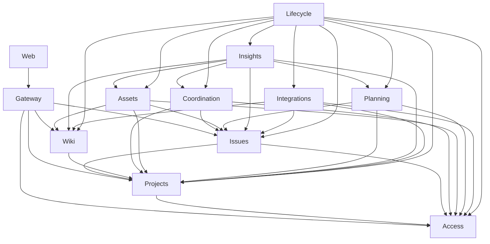

# Projektor modular rewrite — Phase 0

設計案、2026-10-13。実装・配備・データ移行の完了報告ではない。

## 1. 判断

**Cloudflare Workers / D1 / KV / R2 を維持し、単一 Worker の modular monolith として作り直す。** HTTP と MCP は同じ業務 API を呼ぶ。モジュールはテーブル・不変条件・操作結果・履歴を所有し、他モジュールの SQL、ORM schema、transaction participant を受け取らない。ファイルを分割するだけの改修や、旧サービスの一対一移植はしない。

最初の製品は、認証された人と agent が workspace 内の project、issue、wiki を扱えるものとする。必要な操作は、project の作成・参加権限設定・archive、issue の一覧・作成・担当・状態変更・コメント・履歴、wiki の一覧・検索・編集・改訂履歴、同じ操作の REST/MCP、最低限の Web UI。並行編集と通信断で変更を二重適用・上書きしないことも core の完了条件に含む。

最小 core のデータ所有者は **Access、Projects、Issues、Wiki**。Gateway と Web はデータを所有しない接続・表示モジュール。Platform は業務を知らない限定的な基盤である。認証・資格・workspace membership は同じ認可の不変条件を持つため Access にまとめる。一方、Issue と Wiki は原子的に一緒に変更する必要がないので分ける。過去ブランチの大きな Work モジュールは引き継がない。

本 Phase 0 はこの文書だけを変更する。次の scaffolding MR で旧アプリ・旧依存・旧テストを削除し、履歴の `d39852cef35217bc1dbf4c42d646bda1f09994d3` を参照先にする。LICENSE、著作者情報、Git 履歴、運用上のデータは削除対象ではない。ユーザー指定の保存先を優先し、旧 AGENTS.md の「設計は wiki のみ」規則は本件には適用しない。

## 2. 調査の対象と限界

2026-10-13 に fetch 後の以下を読んだ。以降、`main:path:line` はこの固定 SHA 上の行番号。過去ブランチは実行中の製品とも、本設計の承認済み要件ともみなさない。

| 参照 | SHA | 調査対象 |
|---|---|---|
| main | `d39852cef35217bc1dbf4c42d646bda1f09994d3` | apps/api、apps/web、packages/db・types・plugin-sdk、plugins/github、AGENTS.md、SECURITY.md、README、apps/docs、GitHub CI |
| fix/modular-system-integration-20261012 | `8d322a07ec9e29449edb33a192780212c0f07153` | apps/system の設計、registry、境界検査、Work/Identity/Execution の D1 adapter、共有 commit、CI 定義 |
| fix/workspace-boundaries-and-project-scope | `535fde3db1a7e52d20056120881eb81ee3e369d4` | workspace confinement、初回 provisioning、ブラウザの project 解決・一覧、関連テストと履歴 |
| fix/ptordev-6-project-atomicity | `37184634bbd1134b7dafbca7f1a3cf68c60c68d1` | project 書込み・監査の batch 化、unique index、事前診断、回帰テスト |

`fix/modular-system-integration-*` に一致する取得済みリモートブランチは上記 1 本。Taskboard の先頭一覧には本 rewrite 案件はなく、別案件の再開はしていない。本セッションに Projektor の claim 用 MCP はなく、issue の指定もない。専用 git branch で文書 1 ファイルを変更し、fleet claim を取得したとは扱わない。

調査開始時の空き容量は 2.7 GiB。**依存のインストールは行っていない。** 旧 Vitest 全体、ブラウザ、実 Cloudflare、過去ブランチの全テストは実行していない。以下の実行証拠は Python 標準 sqlite3 と Node のみ。SQL の再現、注入した障害、コード上の推論を区別する。

### 2.1 core の具体的な欠陥

| 問題 | 固定 main の根拠 | 確認結果・影響 |
|---|---|---|
| project key の一意性が DB で守られない | `apps/api/src/services/projects.ts:245` の SELECT 後、`:256` で別 INSERT。更新 `:283`, `:302` には重複確認もない。`packages/db/migrations/0056_hot_path_indexes.sql:12` は非 unique index | **実行済み**: 72 migration を適用した SQLite に同一 workspace / 同一 key / 異なる slug の 2 project が入った。並行 create または rename で参照名が曖昧になる。HTTP 並行負荷試験ではなく schema の再現 |
| project 本体と必須監査が別 commit | `services/projects.ts:256`, `:268`、更新 `:302`, `:309`。`services/activity.ts:14` が独立 INSERT | **実行済み**: 現行 createProject 関数本体に audit 例外を注入すると promise が reject しても INSERT 済み行が残る。偽 ORM を使った制御フロー試験であり D1 障害試験ではない。利用者には失敗、データには成功という不一致 |
| 削除が他所有者の内部構造を列挙する | `services/projects.ts:321` の cleanup、`services/workspaces.ts:369`、`services/issues.ts:2017`、`services/wiki.ts:2466` | Project が 28 種類、Workspace が 36 種類のテーブルに書込む。追加された子データ・検索 index・履歴・blob の知識を複数削除箇所へ反映しなければならない。局所変更が局所で閉じない |
| D1 と R2 の部分失敗に回収記録がない | `services/projects.ts:404` の DB 削除後、`:414` の R2 削除失敗をログだけにし、`:422` で成功。Workspace も `:462–475` | **コード上の推論**: metadata 消去後に R2 が失敗すると対象 key を失い orphan が残る。この経路に永続 retry queue はない。故障注入した実 R2 再現は未実施 |
| 業務 API に万能な権限を渡している | `packages/types/src/plugin.ts:63–86`、`services/types.ts:7–31`、`packages/db/src/index.ts:1–8` | ServiceCtx/PluginContext は生の DB・KV・R2 と任意 role を含み、全 schema が export される。「サービスを通す」だけではデータ所有権を制限できない |
| 認証の入口が業務を作る | `middleware/auth.ts:184`, `:313` → `services/provisioning.ts:119`, `:163`, `:311` | ログイン処理が workspace 作成や membership 変更を引き起こす。明示的管理コマンドと認証の責務が結び付く。middleware 内にも資格と membership の JOIN (`auth.ts:224`) がある |

既存の正しい部分まで壊れているとは言わない。`services/issues.ts:883–894` の issue 番号は INSERT 内の subquery と migration `0002_issue_number_unique.sql` によって保護されている。AGENTS.md の「MAX+1 は既知の race」という説明を、現行 issue 作成の未修正不具合として採用しない。workspace confinement の過去の修正も、現行の tenant 漏えい再現と混同しない。

### 2.2 境界越えの広がり

単位は top-level の `.ts` ファイル。母集団は `services=50 / routes=30 / mcp=29 / middleware=4`。下表のソース走査の件数は潜在的な到達範囲で、すべてを実害のある脆弱性と数えたものではない。

| パターン | 規模 | 代表例と判定 |
|---|---|---|
| 他領域のデータへ直接 write | 手動確認だけで **少なくとも 5/50 services**: projects、workspaces、issues、wiki、sprints | Project cleanup は 28 table 中 27 が projects 以外。Workspace cleanup は 36 table（全 workspace 配下を所有するという読み替えはしない）。Issues は agent_sessions / attachments / claim / feedback 等、Wiki は attachments、Sprints は `services/sprints.ts:192`, `:249` で issues を更新。下限値であり全サービスの違反総数とは主張しない |
| 全領域 schema へ直接到達 | **29/50 services** が `@projektor/db` import、**24/50** が異なる `schema.<name>` を 2 種以上参照 | `services/issues.ts` は 17 種、`services/access.ts` は 6 種。後者は Projects/Issues と ACL の SQL を結合。単なる同一モジュール内の複数 table も含むので違反数とは別の指標 |
| SQL/ORM が transport に残る | REST **0/30**、MCP **1/29** | `mcp/workspaces.ts:20–28`, `:115` が Drizzle query。全 REST route が SQL を持つ、という診断は誤り。MCP `windowing.ts` の RegExp `.exec()` は SQL 件数に含めない |
| middleware が永続化と業務を持つ | `.prepare()` は **3/4**: auth、workspace、rate-limit。provisioning 呼出しは auth 1 ファイルの 2 箇所 | `middleware/auth.ts:224`, `:280`、`workspace.ts:33`, `:131`。rate-limit は基盤責務なのでドメイン越境とは分ける |
| isolate 内の可変 cache | services 内で **3 インスタンス**（projects:14、task-types:13、task-statuses:14）、共通実装 `cache.ts:40` | workspace key と TTL はある。別 isolate へローカル invalidate は届かない。認可の正本や強い整合性を必要とする判断には使わない |
| Web の共有可変状態 | `apps/web/src/lib/project-context.ts:18–27` に公開 writable signal **4 個**と private mutable binding **4 個** | workspace reset・遅延応答抑止は実装済み。書込みは現行では同ファイル内だが、export 型は外部 write を許す。これ自体を tenant 漏えいの実証とはしない |
| plugin に DB 権限を渡す | plugin 実装は **1 個**、`plugins/github/src/index.ts:10–17`, `:35–42` | workspace 列のない table と直接 INSERT。`apps/api/src/plugins/registry.ts:28` は singleton だが runtime 登録されていない。将来接続時の欠陥であり、現在公開された脆弱な endpoint とは報告しない |

旧 architecture test は `test/architecture/ctx-retargeting.node.test.ts:12` の特定 spread 正規表現、`fk-cleanup.node.test.ts:1–8` の cleanup allowlist 等。役割として有益な検査もあるが、所有権検査ではない。むしろ全親サービスが全子 table の cleanup を持つ形を要求してしまう。

旧 AGENTS / test の「D1 は FK action を保証しない」も永久制約にはしない。現在の [D1 foreign key 文書](https://developers.cloudflare.com/d1/sql-api/foreign-keys/) は FK enforcement と CASCADE / SET NULL を説明している。新設計では同一所有者内の FK を利用し、別所有者への FK・cascade は禁止する。FTS / R2 / 非 FK 参照の cleanup は別途必要である。

### 2.3 過去の修正から残す知見・残さない構造

| 試み | 有効な知見 | 今回採らないもの |
|---|---|---|
| workspace-boundaries-and-project-scope | token confinement、初回 workspace race、Access service identity、project URL とページング・遅延応答の同期。`project-context.ts` と auth の現行コードにも修正が入っている。main 未到達の commit は末尾の CI commit `535fde3` | 古い事故を現在も再現するかのように列挙しない。共有 DB context と巨大な削除責務は残っている |
| ptordev-6-project-atomicity | `...:apps/api/src/services/projects.ts:239–260`, `:319–322` で project と audit を batch 化。`0072_project_key_unique.sql:10` が NOCASE unique index。重複データを勝手に消さず preflight で止める | Project service が activity table の SQL を所有する修正は今回の境界には適さない。新 Projects が自分の history/receipt を同じ transaction で持つ |
| modular-system-integration-20261012 | 操作 ID、expected revision、結果不明と未適用の区別、同一操作の結果回収、credential/権限の再検査、境界の negative test という方向 | base との差は **759 files / 112,093 additions / 1,175 deletions**。registry は **29 modules / 471 registered files / 154 interfaces（transaction 10）**。現物には SQL fragment を公開する transaction SPI が残る。規模そのものを不正とはしないが、今回の単純な所有境界と段階 MR にはそのまま再利用しない |

最後のブランチの具体例: `apps/system/src/adapters/d1/work/transaction.ts:6–8` は issue 可視性の SQL を export、`work/recovery-policy.ts:13–16` は他側へ渡す SQL 式、`execution/reports.ts:6`, `:11–14` が Work/Identity/Persistence の内部 adapter に依存する。`persistence/commit.ts:25–43`, `:213–228` は認可・業務更新・履歴・snapshot の SQL を集めて実行する。これは原子性を得る方法ではあるが、**モジュールを跨ぐ SQL 実行権限を共有する**。`architecture/README.md:10` と `scripts/architecture/registry.mjs:98–104` は transaction を含む owner cycle を報告だけにし、public-only cycle と runtime file cycle を失敗にする。registry の許可依存自体も `identity → persistence → identity`、`work → persistence → work` を含む。新設計では型・実装・イベント購読を含む owner graph の循環を例外なく失敗にする。

ブランチの認証案（独自 password、長期 session、owner setup 等）は現行 SECURITY.md と異なる。今回それらの必要性は未確定なので、自作 password 基盤や複雑な復旧 UI を初期 core に持ち込まない。

## 3. 製品範囲と配置

### core と後続機能

| 時期 | 含めるもの | 意図的な制限 |
|---|---|---|
| core | workspace membership、個別 machine credential、project と直接 principal grant、issue（固定状態 todo/in_progress/done/cancelled、担当、優先度、コメント）、project wiki（Markdown、revision、検索）、REST/MCP、Web | project を跨ぐ issue 移動なし。workspace wiki、group ACL、custom field/type/status、epic、sprint、anonymous share、外部OAuth connector、file attachment は初期必須にしない。workspace/project/issue は archive。hard delete なし |
| 後続 | Coordination、Assets、Planning、Insights、Integrations、Lifecycle | 必要になったものだけ順に実装する。plugin の任意コード実行と万能 DB context は復活させない |

core の制限は API 互換性の破壊を伴う。旧 endpoint/tool 名を無条件に模倣しない。旧データの廃棄許可を意味しない。移行対象・既存 client 互換性は §10 で owner 判断とする。

```text
apps/worker/                 # composition, Worker fetch/scheduled, Static Assets
apps/web/                    # Web module: 一つの Preact root、明示的 router
modules/<owner>/
  public.ts                  # commands, queries, DTO, versioned event contract のみ
  internal/                  # rules, application, repositories (private)
  storage/                   # module-owned named SQL + migrations
  tests/                     # pure, storage, public-contract tests
platform/                    # scoped storage executor, clock/id, error primitives
gateway/                     # HTTP/MCP mapping, generated wire contract
architecture/modules.json    # ownership, public imports, storage resources
tools/                       # boundary checks, build, test, migration packaging
docs/architecture/           # 本文と採用した変更判断
.gitlab-ci.yml
```

サーバーは TypeScript/Hono、ブラウザは Preact の単一 root と明示的 route state を提案する。既存 Astro islands の横断 singleton に合わせる必要はない。UI の詳細な視覚設計と Computer Use 受入は Web MR で行う。本 phase で未確認の UI を実装済み扱いしない。

1 Worker + 1 D1 で始める。table は prefix と manifest で論理分離する。モジュール毎の D1 や Worker 分割は今は不必要で、配備と障害点だけを増やす。DB 内の論理境界は悪意ある同一プロセスからの sandbox ではない。もし third-party code を実行するなら別 Worker と限定 API が必要で、初期設計の対象外。

## 4. モジュールの所有権と公開面

表の table 名は**新 schema**。旧名を移植する指示ではない。全 business module の table、unique key、cursor に workspace を含める（Access のグローバル principal/client metadata lookup は明示例外）。個々の module が所有する `<prefix>_history`、`<prefix>_operations`、`<prefix>_outbox`、batch の条件検査用 `<prefix>_guards` もその module の private table。consumer には `<prefix>_inbox` / `<prefix>_cursors` を追加できる。これらは共通 global table にしない。

`C` は command、`Q` は query、`E` は永続 event。**依存欄にない呼出しは禁止**。全 module は業務を持たない Platform の primitive にのみ共通依存できる。

| module | 責務 / 排他的所有データ | 公開 interface の最小集合 | 許可する業務依存 |
|---|---|---|---|
| **Access** | 人・machine の識別、資格の検証/取消、workspace と所属。core に MCP OAuth 2.1 authorization server（Web と同じ人のアカウントで MCP client がログイン）を含む。`access_principals`, `access_credentials`, `access_workspaces`, `access_memberships`。step 02 は receipt/history-outbox/guard と一回限りの bootstrap latch も所有し、auth attempts は未導入。02b は `access_oauth_clients`, `access_oauth_workspace_clients`, `access_oauth_codes`, `access_oauth_families`, `access_oauth_tokens` を追加。KV は `access:jwks:<issuer>` と `access:jwks-refresh:<issuer>`。membership/role を KV に cache しない | C `bootstrap`（operator capability）, `createWorkspace`, `inviteMember`, `removeMember`, `changeRole`, `provisionMachine`, `issueCredential`, `revokeCredential`, `archiveWorkspace`, `registerOAuthClient`, `approveOAuthConsent`, `exchangeOAuthToken`, `revokeOAuthToken`, `revokeOAuthClient`; Q `getAuthorizationServerMetadata`, `getProtectedResourceMetadata`, `getOAuthConsent`, `getOAuthClient`, `authenticate`, `requireMembership`, `authorize`, `getPrincipalSummary`, `getMembership`, `getCredential`, `listWorkspaces`, `me`, `meForScope`, `listMembers`, `listOAuthClients`, `readOperation`, `readEvents`; E `WorkspaceCreated`, `MembershipChanged`, `MachineProvisioned`, `CredentialIssued`, `CredentialRevoked`, `WorkspaceArchived`, `OAuthConsentGranted`, `OAuthClientRevoked`, `OAuthTokenIssued`, `OAuthTokenRotated`, `OAuthFamilyRevoked` | なし |
| **Projects** | project identity、key の一意性、project 参加権限と archive。`projects_projects`, `projects_grants` | C `createProject`, `renameProject`, `grantProjectRole`, `revokeProjectRole`, `archiveProject`; Q `getProject`, `listVisibleProjects`, `authorizeProject`, `readOperation`, `readEvents`; E `ProjectChanged`, `ProjectArchived`, `ProjectGrantChanged` | Access |
| **Issues** | issue 本体、番号、状態、担当、コメント、履歴、検索を一つの整合性境界にする。`issues_issues`, `issues_counters`, `issues_comments`, `issues_search`（FTS） | C `createIssue`, `editIssue`, `transitionIssue`, `assignIssue`, `addComment`, `archiveIssue`; Q `getIssue`, `listIssues`, `searchIssues`, `getHistory`, `authorizeIssue`, `readOperation`, `readEvents`; E `IssueCreated`, `IssueChanged`, `IssueArchived` | Projects, Access |
| **Wiki** | project wiki と改訂・slug・検索。`wiki_pages`, `wiki_revisions`, `wiki_search`（FTS） | C `createPage`, `editPage`, `archivePage`; Q `getPage`, `listPages`, `searchPages`, `getRevision`, `listRevisions`, `authorizePage`, `readOperation`, `readEvents`; E `PageCreated`, `PageChanged`, `PageArchived` | Projects |
| **Gateway** | REST/MCP の protocol、HTTP error/status、tool schema と tool annotations。業務 table/key なし | `handleHttp`, `handleMcp`, 公開 OpenAPI/tool catalog。各 operation は所有者の API に一回 dispatch。認証・workspace 解決も Access API の呼出し | Platform（PlatformError の HTTP 対応）, Access, Projects, Issues, Wiki。後続 module は実装 MR ごとに明示追加 |
| **Web** | 表示、route、未保存入力、pending operation。DB/KV/R2 なし。cosmetic localStorage は `ui:*`、下書きは初期はメモリ内 | route components、Gateway から生成した wire client。principal/workspace/project の切替で表示・query cache を破棄 | Gateway の wire DTO/client のみ。server implementation の import 不可 |
| **Coordination** | agent session、issue lease、repo/path claim、fencing、進捗、WIP cap。`coord_sessions`, `coord_leases`, `coord_file_claims`, `coord_reports`, `coord_report_history`, `coord_limits` | C `startSession`, `heartbeat`, `endSession`, `acquireLease`, `renewLease`, `releaseLease`, `setProjectLimit`（interactive workspace owner/admin、OAuth 由来は不可）, `claimFiles`, `releaseFiles`, `reportProgress`; Q `getLease`, `listLeases`, `listClaims`, `getProgress`, `listProgress`, `listSessions`, `getProjectLimit`, `projectSessions`, `projectLeases`, `projectProgress`, `projectClaims`, `readOperation`, `readEvents`; E `LeaseChanged`, `ProgressReported`, `FileClaimForced` | Issues, Projects, Access |
| **Assets**（後続） | binary と attachment link、その lifecycle。`assets_blobs`, `assets_links`, `assets_gc_jobs`、R2 `assets/<workspace>/<blobId>` のみ | C `beginUpload`, `completeUpload`, `linkAsset`, `unlinkAsset`; Q `getMetadata`, `downloadAsset`, `listAssets`, `readOperation`, `readEvents`; E `AssetBegun`, `AssetCompleted`, `AssetLinked`, `AssetUnlinked` | Issues, Wiki, Projects, Access |
| **Planning**（後続） | sprint と issue の計画上の所属。`planning_sprints`, `planning_items`（workspace/project/issue の opaque ID） | C `createSprint`, `scheduleIssue`, `unscheduleIssue`, `closeSprint`; Q `listSprints`, `getSprintItems`, `readOperation`, `readEvents`; E `SprintChanged`, `IssueScheduled` | Issues, Projects, Access |
| **Insights**（後続） | 統合 activity / metrics / 通知対象。`insights_activity`, `insights_metrics`, `insights_subscriptions`, `insights_notifications`, `insights_cursors`。正本の業務判断には使わない | C `subscribe`, `unsubscribe`, `markRead`, `consumeEvents`; Q `getActivity`, `getMetrics`, `listNotifications`, `getSubscription`（Web の監視状態用）。外部配送はここではしない | Access, Projects, Issues, Wiki, Coordination, Planning, Assets |
| **Integrations**（後続） | 外部参照、feedback、webhook の重複防止と配送状態。`integrations_links`, `integrations_sources`, `integrations_feedback`, `integrations_deliveries` | C `registerSource`, `receiveFeedback`, `convertFeedback`, `linkExternalRef`, `deliverWebhook`; Q `getDeliveryStatus`, `listFeedback`。外部接続は限定 port | Issues, Wiki, Projects, Access |
| **Lifecycle**（後続） | workspace/project の段階的 purge の進捗と再試行。`lifecycle_jobs`, `lifecycle_steps` | C `requestPurge`, `resumePurge`; Q `getPurgeStatus`。各対象 owner の型付き maintenance API `freezeScope`, `purgeScope`, `purgeStatus` を使う | Access, Projects, Issues, Wiki, Coordination, Assets, Planning, Insights, Integrations |

Platform は raw Cloudflare binding の唯一の保管場所である。workspace や issue の意味を知らず、`Clock` / `IdGenerator` / `ModuleStore` / prefix 限定 KV・R2 adapter を提供する。業務 table や operation receipt の正本を持たない。migration bookkeeping `platform_schema_versions(owner,version,checksum)` のみ基盤が所有し、実行時業務コードからはアクセス不可。

Access の初期認証は既存 Cloudflare Access の署名済み assertion と hash 保存した workspace-scoped bearer を採用する。人と machine の actor/issuer を区別し、machine の権限は workspace と credential scope で上限を設ける。`provisionMachine` は同 module 内で interactive workspace owner/admin と actor membership を確認し、機械自身の昇格を許さない。MCP から token 発行・取消は公開しない。独自 password は導入しない。owner Q2 により MCP OAuth login は core 必須とし、OAuth 2.1 authorization server は Access part 2（02b）で実装する。通常の authenticate は workspace/membership を作成せず、初期 owner は明示的な一回限りの operator bootstrap で設定する。

Projects は workspace owner/admin と直接 principal grant を扱う。group ベースの ACL を初期から再現する場合は Access が group と group membership、Projects が group grant を所有する拡張とする。Projects は Access の `listSubjectGroups` を使い、group table を JOIN しない。この拡張の採否は §10。

### 4.1 依存 DAG

矢印は **利用側 → 公開 API を提供する側**。イベント consumer も producer の public event 契約に依存する方向で数える。producer は consumer を import / invoke しない。起動時の composition は全 module の factory を配線するだけで業務判断を置かない。



後続提供時の Gateway → 後続 module の辺、および各 module → Platform の辺は図から省略。どちらも逆依存は禁止。CI は省略しない完全な manifest から検査する。Core の順序は Platform → Access（02 / 02b）→ Projects → Issues / Wiki → Gateway → Coordination → Web。後続は Assets → Planning → Insights → Integrations → Lifecycle で実装できる。

Issues は lease を知らない。Coordination は issue の状態を直接変えない。agent の「作業報告」と issue の「完了」は別コマンドにする。lease 所持を issue 編集の必須条件にする要件は初期には入れない（そうするなら lease を Issues の invariant に組み込む境界変更が必要）。Planning は issues.sprint_id を作らず、自分の membership を持つ。これで以前の循環と他領域 UPDATE を避ける。 Step 10 では archive 後の sprint 表示に必要な権限付き履歴読取りが既存の Issues/Projects public API に無かったため、両 owner に `getIssueIncludingArchived` / `getProjectIncludingArchived` を追加する。両 API は元 owner の認可を維持し、Planning は他 owner の表を読まない。

## 5. 操作、認可、整合性

### 5.1 公開 API に渡すもの

```ts
// 説明用の概形。実装は Phase 1 以降。
type RequestScope = Readonly<{
  principal: AuthenticatedPrincipal; // Access 発行の opaque handle
  workspace: WorkspaceHandle;       // Access が live membership と token confinement を確認
  requestId: string;
}>;
type EditIssue = Readonly<{
  issueId: IssueId;
  expectedVersion: number;
  operationId: string;
  title: string;
}>;
interface IssuesApi {
  editIssue(scope: RequestScope, input: EditIssue): Promise<CommandResult<IssueDto>>;
}
```

scope は DB/KV/R2、ORM、Env、任意 role、別 workspace を代入する setter を持たない。opaque handle は Access の factory 内で provenance を検証し、TypeScript の cast だけを信頼境界にしない。Workspace は URL 上の ID を Access へ渡して解決する。header と URL が併存して不一致なら拒否し、body の workspaceId を認可済み context の代用にしない。1 MCP 接続の workspace と token confinement が一致しなければ拒否する。

公開 command の所有 module が schema 検証・認可・不変条件を必ず適用する。Gateway の検査は size、content type、protocol version、CSRF/Origin、credential extraction など transport に限る。Projects の `authorizeProject` は Access の live membership を確認する。Issues / Wiki はその公開 API を呼び、自分の table の workspace/project/object 関係も確認する。知らない tenant の object ID は不存在と同じ応答にする。

一覧でも同じ境界を守る。core は workspace+project 必須とし、まず対象 project を一回認可して owner table だけを keyset pagination する。全 project の My Issues は後続の API 合成または Insights の projection とする。foreign SQL predicate を受け渡して JOIN しない。projection の結果も表示前に現在権限で絞り込み、権限が失われた entity の本文や件数を漏らさない。

### 5.2 原子性の範囲を限定する

同一所有者の command は、業務更新 + history + operation result + 必要な outbox を **一つの D1 batch** で確定する。`operationId` は `(workspace, principal, operationId)` で unique、command kind / target / 入力 hash を固定する。同じ ID・同じ入力は保存済み結果、異なる入力は Conflict。同じ ID の再試行でも現在の閲覧権限を確認してから結果を返す。

version 条件付き UPDATE の 0 rows は SQL エラーではない。owner repository はそれを成功として history/receipt を追加しない。batch 内で expected row count を constraint 付き owner guard table に検査させて abort するか、条件を揃えた INSERT/UPDATE と結果検査で実現する。Phase 1 の基盤試験で「0 rows の stale write が成功 receipt を残さない」を実 D1 互換 runtime 上で証明する。**別 module の guard SQL をこの batch に混ぜない。**

通信断・タイムアウトは `unknown`。operation query の NotFound だけでは並行処理も未適用とは証明できない。同じ ID で回収/再送する。確定後の cache 更新・通知失敗を業務 command の失敗へ変えない。履歴は best-effort notification と区別する。

[D1 batch の仕様](https://developers.cloudflare.com/d1/worker-api/d1-database/) に沿い、逐次の複数 await を transaction と呼ばない。100 bind/query 制限と 30 秒の SQL 実行上限は [現行 limits](https://developers.cloudflare.com/d1/platform/limits/) を基準にテストする。単なる chunk 化で複数 transaction を all-or-nothing と報告しない。大きな一括操作は初期 API から外し、必要時は job として進捗/部分失敗を返す。

### 5.3 認可取消との競合 — 明示的な保証

独立 module の table を一切読まない設計では、Access の revoke と Issues の commit を単一 SQL transaction に含められない。これを API で包んだ SQL SPI で隠さない。

**採択済み Q1: core の契約は、command admission 時の live 認可**。各公開 command の実行直前に Access/Projects を照会する。認可済みで進行中の一つの command は、直後に revoke/archive されても commit し得る。revoke 完了後に認可を開始した新しい command は拒否する。認可済み context の永続保存・キューへの持込み・次要求への再利用は禁止。保存結果の再照会は毎回再認可する。read replica と KV は認可判断に使わない。

「revoke 応答後には以前から進行中の write も一切 commit しない」という強い要件なら、この案のまま実装しない。候補は (a) scope 単位の admission/drain を公開 API で管理する coordinator を追加する（latency、deadlock 回避、crash 回復の負担）、(b) 認可とその業務 aggregate の所有境界を統合する（module が大きくなる）。どちらも代償がある。§10 Q1 は owner が admission 時認可を採択済みである。

### 5.4 event と削除

イベント envelope は `eventId, source, schemaVersion, workspaceId, aggregateId, aggregateVersion, type, occurredAt` と最小 payload。producer 自身が outbox を同時保存する。consumer は producer の `readEvents(cursor, limit)` を明示的な internal service capability で読み、自己 inbox の eventId unique、projection と cursor の同時 commit で at-least-once を処理する。capability は composition が決めた producer/consumer の組に限定し、HTTP/MCP へ公開しない。

Core から outbox の仕様は決めるが、consumer のないイベント配送基盤は構築しない。後続 consumer は scheduled handler による bounded polling と retry/backoff を初期方式とする。KV や `waitUntil` を配送記録の正本にしない。順不同・重複・poison event・schema version 不明時は停滞箇所を記録して観測し、黙って cursor を進めない。

core の archive は Projects/Access が現在の公開可否を直ちに判断し、子 table を消さない。R2 を持つ Assets は metadata を消す前に自分の GC job を永続化する。DB と R2 の原子性は約束しない。pending upload と orphan の回収も Assets の責務。

hard purge は Lifecycle 導入後。親を freeze し、各 owner が自分の storage に frozen marker を保存して新規 write を原子的に拒否し、全 owner の freeze acknowledgement を受けてから各 `purgeScope` を再試行する。遅れて到着した古い command も marker で拒否する。module ごとの完了を記録し、全 child の完了前に親 metadata を消さない。依存先は Lifecycle を import しない。owner 間の delete 順と失敗回復は Lifecycle が所有するが、子 table や SQL は知らない。

### 5.5 Step 02b OAuth の具体化

DCR はログイン・workspace 選択より前に行われるため `access_oauth_clients` の
登録metadataのみglobal例外とする。登録自体は権限を与えず、同意によるclient binding、
code、family、tokenはworkspaceごとに所有する。OAuth principalはWebと同じ人で、
RequestScopeのclientIdで代理clientを区別する。OAuthではAccess管理を許さない。

§5.2のoperationId契約は対話的な同意・client取消に適用する。標準OAuthの登録・
code/refresh交換・RFC7009取消には独自operationIdを要求しない。hashのみ保存する
secretを再送で回収することはできないため、code/refreshの消費を原子的に記録し、
再利用はfamily取消・再認証とする。RFC7009取消は冪等。membership versionの変更は
旧OAuth資格を無効にし、再同意を要求する。理由・寿命・失敗時とGatewayの正確な
HTTP/CSRF契約は [Access仕様](access.md#mcp-oauth-02b-protocol-and-identity) に集約する。

02bは公開clientのDCR互換経路を実装する。現行MCPが推奨するClient ID Metadata
Documentsやconfidential-client認証は広告しない。HTTP routeと実client相互運用は
06の受入であり、02bの単体試験で完了扱いしない。新規依存・本番bindingは追加しない。

## 6. 境界を CI で破れなくする

文言上の規則だけでは不十分。scaffolding の最初の MR から以下を必須 job とし、違反は nonzero exit にする。

1. **Import / owner DAG**: `architecture/modules.json` に module root、public entry、依存、owned table/key prefix を宣言する。dependency-cruiser と TypeScript AST 検査で relative path、alias、package export、type-only import、re-export を解決する。外部から `internal/` / `storage/` / test helper の import、未宣言 dependency、cycle、未所属 source を失敗にする。dynamic require/import は固定 literal の許可先だけ。`any`/double cast による context・storage capability の偽造、runtime code evaluation を許可しない。package exports だけに頼らない。
2. **公開型の検査**: public entry が SQL、D1PreparedStatement、Drizzle schema、Env、ModuleStore、任意 callback transaction、generic `execute/query/tableName` を export したら失敗。public 型の推移的依存も検査する。factory は composition 専用 export で、他 module の呼出し側に storage を渡す factory は不可。Gateway は public commands/queries と wire DTO だけを使用する。
3. **SQL 所有者検査**: SQL は owner の `storage/queries.ts` の named, static query catalog と migration に限定する。値だけ bind し、identifier の文字列連結や他 module からの SQL fragment は禁止。CI の SQLite parser/authorizer で read/write/JOIN/subquery/CTE/FK/trigger/view/FTS の到達 table を解決し、所有 manifest と照合する。FTS shadow table も同じ owner に登録。SELECT だけの他 table 参照も失敗する。DDL は migration のみ。ATTACH、任意 PRAGMA、未承認 virtual module と多文 SQL を禁止する。
4. **capability の絞込み**: raw D1/KV/R2 binding は composition → Platform adapter のみ。owner にはその owner の catalog ID しか実行できない `ModuleStore` を注入する。動的 SQL は adapter 自体にも外から渡せない。KV/R2 wrapper は固定 prefix を検査し、他 owner prefix を拒否する。共通 adapter は schema 名や業務分岐を持たない。named query の manifest と build hash を照合する。CI は別名 alias での raw DB import も拒否する。executor は 100 bind/query 上限も検査し、SQLite の緩い上限に依存したテスト成功を防ぐ。
5. **migration/schema 検査**: 各 owner の migration だけで isolated DB が構築できること、各 table/index/trigger/view が一つの owner に属すること、他 owner FK がないことを確認する。tenant table は workspace ID と tenant-local unique key を持つ。query の tenant predicate の意味は正規表現だけでは証明しないので、二 tenant の実行試験も必須にする。
6. **違反を作る検査のテスト**: cross import、type-only cycle、barrel 漏出、直接 SQL read/write、cross-owner trigger/FK、KV/R2 prefix、Gateway の query、未知 source、動的 SQL、owner 偽装を fixture として一つずつ注入し、各検査が落ちることを検査する。健全な fixture が通ることも確認する。allowlist 自動生成で緑に戻さない。

静的解析は責務の良し悪しや敵対的 maintainer に対する防壁ではない。manifest / checker / CI を同時に緩める変更もレビュー対象とする。shared SQL helper や huge transaction SPI を「宣言済みだから許可」にしない。業務の実行隔離は、依存 module の **公開 contract fake** と **その module だけの schema** でテストできることによって確認する。

## 7. テストと GitLab CI

### 7.1 各モジュールを単独で試す

| 層 | 入力と証明すること |
|---|---|
| rules | fake clock/id、状態遷移、invalid input、role、version、同じ operation ID の異入力。ネットワーク/DB なし |
| module public API | 自分の real repository と依存先 public contract fake。他 module の migrations/test factory を import しない。fake の挙動は provider 自身に同じ contract suite を適用して整合させる |
| storage | workerd/Miniflare D1/R2/KV。owner の migration のみ。transaction 内の途中失敗、stale UPDATE 0 rows、同時 create/rename、重複再送、response loss、restart、prefix 分離。SQLite 実行時 authorizer も SQL 到達 table を検査 |
| tenant / authorization | 2 workspace、2 project、human と machine、read/write scope、membership/credential revoke、異 tenant ID、ACL 変更。Q1 で採用した revoke race の契約を実行順制御で確認 |
| transport contract | 同じ成功/入力不正/不存在/権限/競合/unknown の fixture を REST と MCP に通す。binary upload/download と credential 管理の surface 例外は明示 manifest で検査 |
| browser | local Worker と Web を localhost で起動。login fixture、issue 作成→更新→履歴、wiki 編集競合、失敗/unknown 時の入力保持、workspace/actor 切替後の遅延応答遮断。Playwright と主担当 Computer Use を併用 |
| platform smoke | main のみ、実 D1 の batch rollback・bind cap・migration・R2 GC を専用検証環境で実行。ローカル SQLite の成功を実 D1 の制限保証と取り違えない |

DB uniqueness と CAS を必須とし、単体 fake だけで並行性を合格にしない。module の read model は遅延してよいが、権限と command invariant の正本にはしない。テストのために visibility/constraint を緩めない。

### 7.2 pipeline の設計

調査時、main に `.gitlab-ci.yml` はなく `.github/workflows/ci.yml` がある。GitLab project 286 の API は `ci_config_path=null`, `shared_runners_enabled=true`, `only_allow_merge_if_pipeline_succeeds=false`。main は Maintainer push/merge の保護。**「CI が失敗する」と「失敗 MR を merge できない」は別**で、Phase 1 の受入には pipeline 必須設定の有効化も含める。本 phase では設定変更しない。

Phase 0 の初回 push 後、`auto_devops_enabled=true`, `auto_devops_deploy_strategy=continuous` も確認した。[pipeline 14036](https://gitlabce.vp25.home/astra/projektor/-/pipelines/14036) には汎用 build/test/code_quality/SAST/container_scanning/secret_detection が作られた。したがって「YAML がないので CI は起動しない」とは扱わない。この Auto DevOps pipeline は本設計の gate ではなく、Phase 1 で明示 YAML に置き換え、意図しない自動配備がないことも確認する。

runner は docker-based shared runner。MR/feature branch では Cloudflare token、deploy ID、private registry secret 等の project CI/CD variables が一切ない前提とする。これは本環境の条件であり、GitLab の全構成の一般則ではない。[GitLab MR pipeline](https://docs.gitlab.com/ci/pipelines/merge_request_pipelines/) と [variables](https://docs.gitlab.com/ci/variables/) の仕様を踏まえ、保護変数を MR に渡す設定へ変更しない。

以下は **scaffolding MR で実装する `.gitlab-ci.yml` の構造案**。現時点で動作する pipeline として添付したものではない。toolchain image の Node/pnpm/Playwright version と digest は同 MR で存在・pull・起動を検証して固定する。MR job が private registry を必要としない public image と public dependency だけで動くことを確認する。

```yaml
workflow:
  rules:
    - if: '$CI_PIPELINE_SOURCE == "merge_request_event"'
    - if: '$CI_COMMIT_BRANCH == $CI_DEFAULT_BRANCH'
    - if: '$CI_COMMIT_BRANCH && $CI_OPEN_MERGE_REQUESTS'
      when: never
    - if: '$CI_COMMIT_BRANCH'
stages: [verify, test, build, smoke, deploy]
# default image / cache / before_script は固定 toolchain と frozen install。
# 各 job は独立 container で必要な public 依存だけを install。
boundaries:
  stage: verify
  script: ["pnpm check:boundaries", "pnpm test:boundary-checkers"]
static:
  stage: verify
  script: ["pnpm lint", "pnpm typecheck", "pnpm check:contracts"]
modules:
  stage: test
  script: ["pnpm test:modules --coverage", "pnpm test:migrations"]
integration:
  stage: test
  script: ["pnpm test:transport", "pnpm test:recovery", "pnpm test:browser"]
build:
  stage: build
  script: ["pnpm build", "pnpm check:artifact"]
  artifacts:
    paths: [dist/]
    expire_in: 7 days
cloudflare-smoke:
  stage: smoke
  rules:
    - if: '$CI_COMMIT_BRANCH == $CI_DEFAULT_BRANCH && $CI_COMMIT_REF_PROTECTED == "true"'
  script: ["pnpm smoke:cloudflare"]
deploy:
  stage: deploy
  resource_group: production
  rules:
    - if: '$CI_COMMIT_BRANCH == $CI_DEFAULT_BRANCH && $CI_COMMIT_REF_PROTECTED == "true"'
      when: manual
  allow_failure: true # optional deploy button; verification failures are never optional
  script: ["pnpm deploy:artifact"]
```

全 verify/test/build job は main と MR の両方で必須、`allow_failure` なし。初期は path filter で飛ばさず、依存 module の変更も全 contract に当てる。JUnit/coverage/browser trace は失敗時も artifact にする。artifact に `.dev.vars`、認証 cookie、token、実 payload を含めない。cache は lockfile hash と job 用途で分け、古い node_modules を正しさの根拠にしない。docker-in-docker、host socket、SSH to VM、production DB を local test に必要としない。

Cloudflare smoke は専用検証用 binding だけに接続する。Q5 の所有者判断で main の smoke を有効化し、保護変数が欠ける間は exit 78 の warning として表示する。実 D1 の検査を通るまでは公開配備可能とは判定しない。core MR は secret-free gates でレビュー可能だが、本番切替には real-platform smoke が必要。main 専用 smoke の exit 78 以外の失敗は pipeline を失敗させる。配備には build artifact の commit SHA と checksum を照合し、再 build しない。詳細は [Cloudflare smoke](cloudflare-smoke.md)。

旧 release workflow の「main merge で運用系に影響しないか」も scaffolding で点検する。旧 GitHub release/docs/deploy workflow と bootstrap を除去/停止し、旧 production binding へ scaffold を deploy しない。main への source merge と稼働環境切替は分離する。

## 8. 実装順序 — 1 step / 1 branch / 1 MR

全 MR は直前の merge 済み main から作り、巨大な stacked integration branch は作らない。各 module は最小の公開操作だけで完結させ、HTTP/MCP/UI の全 feature を一度に実装しない。共通受入は boundary checker、型/lint、isolated module tests、tenant/retry/concurrency の該当試験、公開契約・docs 同期。merge は owner のレビュー対象。

owner の利用目的は OpenAI Dots、Codex、Claude Code など複数 agent にまたがる統合タスク管理である。そのため 06 Gateway → 08 Coordination → 07 Web の順に実装する。既存の step 番号・branch 名は変更せず、実行順だけを変更した。

| 順序 / branch | 変更する module とレビュー範囲 | 固有の受入条件 |
|---|---|---|
| 00 `rewrite/00-architecture` | この設計文書のみ | 根拠の SHA/行番号、実行した再現、所有表、DAG、CI、未決事項。MR 作成まで、merge しない |
| 01 `rewrite/01-scaffold` | 旧 apps/packages/plugins/lockfile/legacy checks の除去、新 skeleton、Platform、boundary tooling、GitLab CI。README/AGENTS/SECURITY を新しい境界・実装段階に同期。削除 diff と新規基盤 diff を別 commit にする | 旧 runtime import がゼロ。ライセンス保持。secret-free shared runner で全基盤 gate が動き、各違反 fixture が失敗する。2 個の仮 owner schema で cross-table read/write を拒否。stale CAS/rollback の基盤試験。main の pipeline 必須化を確認。deploy 無効 |
| 02 `rewrite/02-access` | Access の最小外部認証 adapter、workspace/membership、owner bootstrap、scoped machine credential | owner が他 workspace へ権限を持ち込めない。actor/issuer 区別、token hash 保存、失効/降格/期限、通常 authenticate の provisioning 無副作用。自己 schema のみで isolated test。Q1/Q2/Q3 の採択済み契約を反映 |
| 02b `rewrite/02b-access-oauth` | Access part 2: MCP OAuth 2.1 authorization server、Web と同じ Cloudflare Access identity での login、MCP authorization spec 対応 | claude.ai connectors 等の MCP clients がログインできる。独自 password なし。OAuth の discovery / authorization / token / scope / PKCE / refresh・revoke と負の security contract を仕様に沿って試験。Gateway への接続契約を用意 |
| 03 `rewrite/03-projects` | Projects、直接 principal grant、archive | 同 workspace key unique を並行 create/rename で検証。project/history/receipt の一括 rollback。非参加者は存在も見えない。Access fake の provider contract が一致。Q3 決定反映 |
| 04 `rewrite/04-issues` | Issues: 固定状態、番号、担当、コメント、履歴、検索 | create/edit/transition の version と同一操作再送、response loss 回収。issue number の一意性。Issues schema に Projects/Access table が存在しなくても動く。foreign DB read/write ゼロ |
| 04a `rewrite/04a-audit-projects-issues` | 独立test audit、Projects/Issuesの回帰検証、日本語検索と代理client帰属 | 各public操作の不変条件をテストへ対応づけ、変異を実行して検出力を確認。既存migrationを維持し、trigram再構築と短語のproject限定LIKE、history/comments/eventsへのclientId追加。詳細は[test audit](test-audit.md) |
| 05 `rewrite/05-wiki` | Wiki: project pages、revision、slug、検索 | 並行 edit で revision を失わない。body/FTS/history/receipt の整合。知らない project の page/revision が見えない。Issues なしで単独 test |
| 05a `rewrite/05a-audit-access-wiki` | 独立test audit、Access/OAuthとWikiの公開契約・変異・攻撃者視点の検証 | KV由来JWKSの偽鍵受理を修正し、設定済みHTTPSから取得した鍵だけをverifier内で保持する。cold startの取得増加はGatewayの入口rate limitで制御する。各操作とテストの対応・変異結果・残存リスクは[test audit](test-audit.md) |
| 06 `rewrite/06-gateway` | Gateway、Worker composition、REST/MCP の最小 catalog | 同じ fixture で surface parity。scope 不一致、未知 tool、binary/credential の明示例外。route に SQL/業務分岐なし。各 command の API 契約と生成 docs 一致。Claude Code / Codex / Dots 型 client の MCP Streamable HTTP 相互運用を OAuth login と bearer の両経路で検証 |
| 08 `rewrite/08-coordination` | Coordination: sessions / fenced lease / file claims / progress | 同時 acquire の winner が一人、失効 lease の renew/report 拒否、restart 後の durable recovery。Issue 本体の状態を更新しない。WIP cap は自身の table の invariant |
| 08a `rewrite/08a-audit-gateway-coordination` | Gateway / Coordination independent test audit; bounded append-only progress timeline | Required transport and fencing mutations must fail behavioral assertions; retain latest read and newest-first keyset history (1,000 per issue). See [test audit](test-audit.md). |
| 07 `rewrite/07-web` | Web: login 状態、project 選択、issue/wiki 主操作、pending/unknown 表示 | 実画面で主担当が作成→編集→履歴・競合・workspace 切替まで操作。actor/workspace 変更で旧 response を表示しない。入力失敗時に内容を失わない。secret-free local browser CI。主要 Web 操作を実装 |
| 07b `rewrite/07b-core-contracts` | Access の principal/workspace 発見、member/client 管理、Coordination の project 単位の稼働一覧/WIP cap を公開し、Gateway REST/MCP と Web を接続 | 権限・tenant 分離、失効の即時性と一括 rollback、keyset pagination、REST/MCP parity、2 agent SDK E2E、初回 login と UI 取消の browser 検証。MR merge により最小 core の契約が揃う |
| 09 `rewrite/09-assets` | Assets: upload/download/link/GC | 他 module table に link metadata を追加しない。R2 故障・応答断・再送後も job が残り回収できる。archive/revoke 後 download 拒否。binary REST と MCP metadata の例外を catalog に明記 |
| 10 `rewrite/10-planning` | Planning: sprint と items | sprint 削除/終了が Issues UPDATE を発生させない。無権限 issue の schedule 拒否。archived issue の読取り/表示を定義。失敗再送で重複 item なし |
| 11 `rewrite/11-insights` | Insights: activity projection と最小 metrics | duplicate/out-of-order event の再生が安定。consumer crash 後に欠落しない。projection 遅延を表示し、revoke 後に本文・件数を漏らさない。巨大な分析/通知 engine を追加しない |
| 12 `rewrite/12-integrations` | Integrations: まず external ref と feedback→issue | webhook/feedback 重複抑止。issue 作成 API の operationId を同じ値で再試行し、途中失敗が二重 issue を作らない。外部資格を context に広げない |
| 13 `rewrite/13-lifecycle` | Lifecycle: freeze と purge job | 全 owner freeze 後の遅延 write 拒否。各境界で crash しても resume 可能。R2 GC 完了まで parent 消去を完了扱いしない。他 owner の SQL が一行もない |

Step 07 で見つかった公開契約の欠落は 07b で補った。`/api/me` は既知の workspace ID なしで principal と所属 workspace を返し、Access が member/client 管理を、Coordination が project 単位の agent 稼働と WIP cap を所有する。Gateway は公開契約だけを REST/MCP に翻訳し、Web はその結果を表示する。07b の merge 後、最小 core の契約は完成と記録する。実 Cloudflare D1 smoke と本番切替は別の判断条件である。

Step 08 以降の拡張 module は core 完成の条件ではない。既存機能の単純 port のために追加しない。epic/custom field/workspace wiki/group を要求する場合は、そのデータ所有者の公開契約を拡張する独立 MR として再見積もりし、未実装の機能を上表の完了に紛れ込ませない。

データ移行と本番切替は別の運用判断。新規 D1/R2 namespace へ owner 別 importer（旧 snapshot を入力し公開 import command を呼ぶ）で dry-run → 件数/参照/履歴検証 → 書込み停止または差分取込み → 切替、とする。実データへの実行計画は Q4 決定後に別 MR で具体化する。新しい意味に合わない状態は勝手に正規化せず report する。旧 DB と release を保持し、切戻し時に新規 write をどう扱うか決まるまで本番公開しない。

## 9. Phase 0 の実行証拠と再実行方法

リポジトリの依存を使わず以下を実行した。コードブロックは設計判断の再現資料であり、新 runtime の実装ではない。参照 checkout は `d39852c` にする。文書完成後に全 3 ブロックを文書から抽出して再実行し、すべて exit 0 を確認した。Mermaid の 12 node / 36 edge に循環がないことも走査した。旧アプリの全 gate と GitLab pipeline を合格したという意味ではない。

### A. migration に同一 project key が通る

```sh
python3 - <<'PY'
import pathlib, sqlite3
db = sqlite3.connect(':memory:')
files = sorted(pathlib.Path('packages/db/migrations').glob('*.sql'))
for path in files:
    db.executescript(path.read_text())
db.execute("INSERT INTO workspaces(id,name,slug,created_at) VALUES('w','W','w',1)")
for i in (1, 2):
    db.execute("""INSERT INTO projects
        (id,workspace_id,name,key,slug,created_at,updated_at)
        VALUES(?, 'w', ?, 'DUP', ?, 1, 1)""", (f'p{i}', f'Name{i}', f'name{i}'))
print(len(files), db.execute('SELECT id,key,slug FROM projects').fetchall())
assert db.execute("SELECT count(*) FROM projects WHERE key='DUP'").fetchone()[0] == 2
PY
```

実測: `72 [('p1', 'DUP', 'name1'), ('p2', 'DUP', 'name2')]`。最初の fixture は workspace に存在しない updated_at を指定して失敗したため、schema に合わせて上記へ訂正して再実行した。製品不具合として数えたのは訂正後の結果である。

### B. audit 失敗後に project insert が残る

```sh
node --input-type=module - <<'JS'
import fs from 'node:fs';
import vm from 'node:vm';
import assert from 'node:assert/strict';
const source = fs.readFileSync('apps/api/src/services/projects.ts', 'utf8');
const fn = source.slice(source.indexOf('export async function createProject('),
                        source.indexOf('export async function updateProject('))
  .replace('export ', '').replace('ctx: ServiceCtx, input: unknown', 'ctx, input');
const rows = [];
const orm = {
  select: () => ({from: () => ({where: () => ({get: async () => undefined})})}),
  insert: () => ({values: async row => { rows.push(row); }})
};
const context = vm.createContext({crypto, Date, drizzle: () => orm,
  schema: {projects: {}}, and: () => null, eq: () => null,
  CreateProjectSchema: {safeParse: input => ({success: true, data: input})},
  generateUniqueSlug: async () => 'sample',
  recordActivity: async () => { throw new Error('audit unavailable'); },
  invalidateProjectsCache: async () => {},
  ForbiddenError: Error, ValidationError: Error, ConflictError: Error});
vm.runInContext(fn, context);
await assert.rejects(context.createProject({workspaceId:'w', role:'owner'},
  {name:'Sample', key:'SAMPLE'}), /audit unavailable/);
assert.equal(rows.length, 1);
console.log('rejected; inserted row count =', rows.length);
JS
```

実測: `rejected; inserted row count = 1`。Node v22.22.1 の `stripTypeScriptTypes` はこの VM の build では無効だったため、固定関数の signature だけを上記の通り除去した。業務本体は書き換えていない。schema/認可や Drizzle 実装の正しさをこの fake で証明したとは言わない。

### C. 広がりの計数

```sh
python3 - <<'PY'
import pathlib, re
root = pathlib.Path('apps/api/src')
for area in ('services', 'routes', 'mcp', 'middleware'):
    files = list((root / area).glob('*.ts'))
    print(area, 'files', len(files), 'db import',
          sum('@projektor/db' in p.read_text() for p in files), 'prepare',
          sum(bool(re.search(r'\.prepare\s*\(', p.read_text())) for p in files))
services = list((root / 'services').glob('*.ts'))
print('services with >=2 schema names', sum(
    len(set(re.findall(r'schema\.(\w+)', p.read_text()))) >= 2 for p in services))
for name, label in [('projects', 'PROJECT_CLEANUP_SQL'),
                    ('workspaces', 'WORKSPACE_CLEANUP_SQL')]:
    src = (root / 'services' / f'{name}.ts').read_text()
    block = src[src.index('const ' + label):].split('\n];', 1)[0]
    targets = sorted(set(re.findall(r'\b(?:DELETE\s+FROM|UPDATE)\s+(\w+)', block)))
    print(label, len(targets), targets)
PY
```

実測: services `(50,29,21)`、routes `(30,0,0)`、mcp `(29,1,0)`、middleware `(4,0,3)`、複数 schema 参照 24、cleanup targets 28/36。SQL target 名は migration で実在する table と照合した。grep 型の走査なので、権限の伝播や全動的 query の到達先を網羅する証明ではない。§2.2 はこの限界を保った集計である。

## 10. owner decisions と未決事項

2026-10-13 の owner decisions を反映。Q1–Q3 は採択済み、Q4/Q5 は未決。source merge は配備やデータ変更の承認ではない。

| ID / 決める時期 | 問い | 提案と代償 |
|---|---|---|
| **Q1 / 決定済み** | revoke/archive と進行中 write | admission-time live authorization を採択。取消前に admission 済みの処理は commit し得る。取消完了後に admission を始める新しい処理は拒否する |
| **Q2 / 決定済み** | 認証と MCP login | 人は Cloudflare Access signed assertion、machine は hash 保存した workspace-scoped bearer。加えて MCP OAuth login（OAuth 2.1 authorization server、Web と同じ人のアカウント）を core に含む。独自 password なし。02 は assertion/bearer、02b は OAuth |
| **Q3 / 決定済み** | core の製品範囲 | direct principal grant、固定状態 todo/in_progress/done/cancelled、project wiki、archive-only の最小 core を採択。group ACL 等は後続 |
| **Q4 / importer・切替設計前** | 既存データ・履歴・ID・URL・tool 名の維持範囲、停止許容時間、旧稼働版の保持期間 | 新 storage へ検証付き移行し旧 DB を保持。コード廃棄とデータ廃棄を分ける。旧 system branch を既存 production と仮定しない |
| **Q5 / real-platform smoke 有効化前** | 検証用 Cloudflare resource/budget、main だけの smoke と手動 deploy の運用、MR 必須 pipeline 設定 | secret-free MR gates + main 専用検証環境 + 手動本番切替。現行 GitLab 設定は失敗 pipeline の merge を禁止していないので Phase 1 で是正する |

Phase 0 の成果は設計判断と MR であり、これらの問いへの黙示承認、新 system の完成、データ移行の承認を意味しない。

### Step 02 の具体化

[Access implementation](access.md) に role、bootstrap、credential 再送、global identity の例外と試験を記録した。`access_events` は同一 commit の immutable history と outbox を兼ねる。認証失敗の永続記録はこの段階では必要なく `access_auth_attempts` を作らない。公開型検査は union の全構成型を検査した後の重複走査を修正した（文字列リテラル union の標準 String メソッドを外部型と誤検出していた）。D1、SQL literal、callback を union に隠す負の fixture を追加し、境界を緩和しない。

### Step 04a audit refinements

Owner指定の日本語部分一致を満たすため、Issues検索をunicode61の単語一致から
trigramの部分一致へ変更する。1–2文字を含む検索は固定queryのescaped LIKEで
認可済みprojectに限定し、入力256文字・12語・返却100件を上限とする。詳細と
性能上の限界は[Issues仕様](issues.md)。actor kindだけでは代理clientを区別できない
ため、Accessの公開RequestScope.clientIdをIssuesの履歴・コメント・イベントに保存し
公開DTOへ追加する。旧データはnullとし、移行で帰属を推測しない。

既存migrationの改変を避けるため、追加migrationで所有FTSを再構築する。検査器は
SQLite内部のFTS DROP時data_versionとPython注入BEGINを利用者SQLと混同していた。
前者を所有virtual tableの正確なDROPに限定して扱い、後者をautocommit接続で発生
させないようにする。明示PRAGMA/transaction・他owner DROP・runtime DDLの拒否は
負のテストで維持する。owner依存・storage境界・生bindingの流れは変更しない。


### Step 06b HTTP integration decisions

Use one configured OAuth resource (`issuer + /mcp`) for all MCP workspace paths;
REST rejects OAuth. This replaces 06a's request-derived per-workspace audience.
The GET/POST one-time form requirement needs strongly consistent shared state:
Gateway memory loses replay knowledge on restart and KV cannot guarantee a
single consumer. Therefore 06b narrowly extends Access with a tenant-local
`access_oauth_forms` table and public issue/consume operations; Gateway retains
no OAuth database or SQL. The envelope binds all display/approval inputs and
consumption fails closed before the existing approval command. The existing Platform edge now supplies a small native rate-limit adapter and
composition declares two per-IP rate bindings; no account resources are provisioned.
No owner edges, checker exceptions or business commands are added. See
[Gateway](gateway.md#step-06b-oauth-http) for exact contracts and limits.

The browser review also corrected the consent document's referrer policy from
no-referrer to origin-only: Chrome otherwise sends `Origin: null` on form POST,
which conflicts with the mandatory exact-Origin check. Callback responses retain
no-referrer; authorization query data never enters the referrer. CSP permits
only self and the already validated callback origin for the form redirect chain.

### Step 10a audit refinements

`getSprintItems` now uses bounded keyset pagination (default 50, max 100) with
`nextCursor`; REST/MCP and Web carry the page through. This corrects the unbounded
Issues fan-out in step 10 while preserving live, authorized historical reads.
The Planning dependency table/DAG now lists Access, matching the already merged
manifest and admission-time scope checks; no new runtime dependency is introduced.
